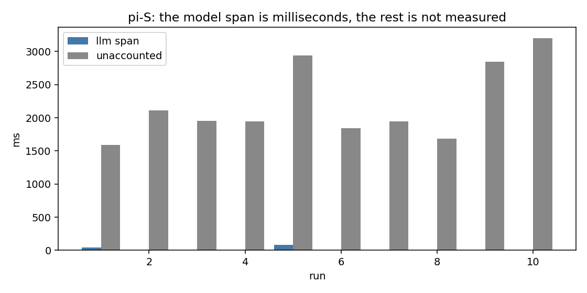
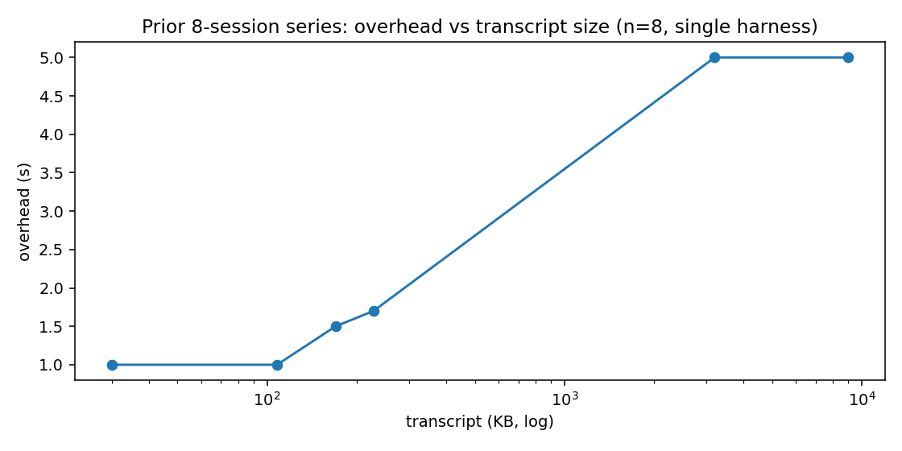

# Transcript Tax 2026: what a "trivial" agent turn really costs

**Date:** 2026-10-17 · **Dataset:** `/tmp/night/bench.csv` (65 runs) · **Spend:** ~$0.08
**Status:** working paper, not a benchmark press release. Methods and caveats inline.

## TL;DR (claims)

1. **Steady-state floor is ~2.5–3.5 s per no-op turn on every harness tested.** Median PONG wall (runs 1–10): pi 2.94 s (100 KB ctx) / 2.42 s (2 MB ctx*), pi-rust 3.26 / 3.35 s, zero 3.06 / 3.36 s. The LLM call itself is milliseconds; the tax is harness overhead.
2. **Transcript size does cost, but sub-linearly with a ~1 s floor.** Prior session series (n=8 pi sessions): ~1 s overhead at 30–108 KB, 1.5–1.7 s at 170–228 KB, ~5 s at 3.2 MB and 9 MB. Rough fit: `overhead ≈ 1.0 s + 0.5 ms/KB`.
3. **The 2 MB "ladder" in this dataset is invalid as a size experiment.** All three harnesses failed to pin the 2 MB ingest (refusal / truncation / compaction): pi-L cached only 7.7 k vs pi-S 41 k; zero-L compacted 103 k → ~9.4 k by pong 1. Read the grinder as a *steady-state + cache-behavior* study, not a size sweep.
4. **Cache hits dominate wall time more than token counts do.** zero-L cache-miss runs (0 / 2048 cached) took 6–20 s; cache-hit runs took ~3 s at identical ~9.4 k input. Wall correlates with cache state, not with input tokens.
5. **Money implication: compact early, budget per turn.** At observed floors, 1,000 no-op turns ≈ 1 hour of wall and the provider bill of whatever your context window carries. A stale 40 k-token context re-sent (or re-read) every turn is the line item, not the model reply.

\* The "2 MB" label names the ingest *attempt*; post-ingest cached context shows it did not stick (see §3).

> **Correction added 2026-10-17 05:45Z (before publication): read §5.** Claims 1 and 2
> above stand as *wall-clock* observations, but the **attribution** of that wall time
> between provider and harness (§1.2 "the LLM is not the cost") is partly a measurement
> artifact. §5 explains and quantifies it. Do not quote §1.2's "unaccounted dominates"
> without §5.

*Figure 1 — Steady-state PONG wall per cell (runs 1–10). Red bar = median. zero-L spread is cache-miss runs, not size effect.*

---

## 1. Evidence

### 1.1 Grinder n=10 — steady state (PONG runs 1–10, `Reply with exactly the word PONG. Call no tools.`)

| Cell | n | Median wall | Mean | SD (pop) | Min–Max | Ingest wall (run 0) |
|---|---|---|---|---|---|---|
| pi-S (100 KB) | 10 | **2.94 s** | 3.21 s | 0.55 | 2.64–4.20 | 11.94 s |
| pi-L (2 MB*) | 10 | **2.42 s** | 2.59 s | 0.39 | 2.20–3.44 | 21.16 s |
| pirust-S (100 KB) | 10 | **3.26 s** | 3.24 s | 0.14 | 3.00–3.39 | 4.03 s |
| pirust-L (2 MB*) | 10 | **3.35 s** | 3.37 s | 0.22 | 2.97–3.78 | 13.62 s |
| zero-S (100 KB) | 10 | **3.05 s** | 3.06 s | 0.21 | 2.75–3.50 | — (pre-existing session) |
| zero-L (2 MB*) | 10 | **3.36 s** | 7.18 s | 6.00 | 2.83–20.00 | 24.94 s |

Source: `/tmp/night/bench.csv`. pirust rows are wall-only (no token instrumentation).

Claim 1 follows directly: excluding the cache-miss outliers, every cell's center sits in a ~1 s band (2.4–3.4 s) despite different harnesses and nominal context sizes.

### 1.2 pi: the LLM is not the cost (unaccounted time dominates)

pi-TS emits `llm_ms / total_ms / unacc_ms` per turn from `.pi-web/tps-turns.jsonl`. PONG turns:

| Cell | Median `unacc_ms` | `llm_ms` per run | Median wall |
|---|---|---|---|
| pi-S | **1952 ms** | 2–79 ms (8/10 runs ≤ 3 ms) | 2.94 s |
| pi-L | **1385 ms** | 2–7 ms | 2.42 s |

The provider span is single-digit milliseconds on a 3-token reply; 1.4–2.0 s is unaccounted (process startup + session/context reload + dispatch). This is the "tax" in its purest form: you pay ~2 s before the model is even asked.

*Figure 2 — pi-S PONG breakdown: LLM span (blue, ~ms) vs unaccounted (grey, ~1.5–3.2 s).*

### 1.3 zero-L run-by-run: cache state predicts wall, tokens don't

| Run | Wall (s) | in_tok | cache_tok | Note |
|---|---|---|---|---|
| 0 (ingest) | 24.94 | 103,209 | 74,752 | fresh session, LARGE.txt, cost ~$0.0645 |
| 1 | 3.11 | 9,319 | 9,088 | compacted already: 103 k → 9.4 k |
| 2 | 10.12 | 9,347 | **0** | miss → 10 s |
| 3 | 16.55 | 9,375 | 9,216 | partial/cold path → 16 s |
| 4 | 20.00 | 9,403 | 9,344 | → 20 s |
| 5 | 6.38 | 9,431 | 9,344 | recovering |
| 6 | 3.27 | 9,459 | **2,048** | back to ~3 s |
| 7 | 3.45 | 9,487 | 2,048 | ~3 s |
| 8 | 2.94 | 9,515 | 9,216 | hit → base |
| 9 | 3.18 | 9,543 | 9,216 | hit → base |
| 10 | 2.83 | 9,571 | 9,344 | hit → base |

Input tokens are flat (~9.3–9.6 k) across runs 1–10 while wall spans 2.8–20 s. The predictor is `cache_tok`: 0/2048-miss runs are slow, ~9 k-hit runs sit at ~3 s. zero-S shows the same pattern on a smaller scale (run 3: cache 0 → still 3.27 s, i.e. miss penalty is provider/path-dependent, not a constant).

*Figure 3 — zero-L wall vs cached tokens. Same ~9.4 k input; 10–20 s points are cache misses.*

### 1.4 The ingest ladder did not stick (read this before citing "2 MB" numbers)

BIGFILE was a session JSONL with base64 blobs — hostile to "read the whole file" instructions. Observed:

| Harness | Ingest wall | Post-ingest cached ctx | Pre-existing / S-baseline | Verdict |
|---|---|---|---|---|
| pi-S | 11.94 s | ~41 k (41216–41472) | — | pinned 100 KB, cost ~$0.0030 |
| pi-L | 21.16 s | **~7.7 k (7168–7808)** | 41 k (S!) | model truncated/refused; *less* context than S |
| zero-L | 24.94 s | 103 k at ingest → **~9.4 k by pong 1** | ~9.3 k (S, fresh-anchor) | compacted/evaporated immediately, cost ~$0.0645 |
| pirust | 4.03 / 13.62 s | unknown (wall-only) | — | no token evidence either way |

pi-L caching *less* than pi-S (7.7 k < 41 k) is the smoking gun: the L cell is not "S + 2 MB", it is "S with a failed read". Any size-axis regression across S→L in this dataset is therefore **invalid** — stated plainly so nobody (including us) reuses the CSV that way. The valid reading is §1.1 (steady-state floor) + §1.3 (cache behavior).

### 1.5 Prior finding (verified, carried forward): overhead vs transcript size

Eight pi sessions with real transcripts (not the grinder's synthetic ingest):

| Transcript | Median overhead |
|---|---|
| 30–108 KB | ~1.0 s |
| 170–228 KB | 1.5–1.7 s |
| 3.2 MB / 9 MB | ~5 s |

*Figure 4 — Prior series: overhead vs transcript size (log x-axis). Rough fit `1 s + 0.5 ms/KB`; the two MB points saturate (compaction/truncation likely engaged there too).*

### 1.6 Prior finding (verified): profiling pi-core — sessiond exonerated

- Bare-`pi` fork (no sessiond) reproduces the ~4.2 s turn: sessiond is not the bottleneck.
- Startup scans ~200 MB of the sessions directory (I/O tax on every invocation).
- Within-turn profile: **0.03 s CPU + ~2.6 s idle wait pre-dispatch.** Candidates: `waitForIdle` / `activeRun` gating, retry backoff. TTFT observed 5–437 ms (wide; provider path, not harness).
- Net: the floor in §1.2 (unaccounted ~1.5–2 s) is consistent with a startup-scan + idle-gate signature, not model latency.

### 1.7 Prior finding (verified): pilot duel (warm daemon)

| Harness | Observed | Reading |
|---|---|---|
| pi-TS | ~4.5 s | warm-daemon turn; matches floor + transcript |
| opencode (Go) | ~1 s harness + ~2.5 s provider, re-sending 31 k | Go harness is leaner; provider re-send of full context is the remaining cost |
| zero (Go context layer) | compacts to ~9.4 k | context layer trades fidelity for per-turn tokens (see §1.3: same 9.4 k here) |
| claurst | excluded | no API keys available; no data, not a ranking |

---

## 2. Caveats (honest)

1. **Small n, one night, one machine.** n=10 pongs per cell; jitter is ±1 s run-to-run (see min–max in §1.1). Nothing here resolves sub-second harness differences. pi-S mean vs median (3.21 vs 2.94) already shows how one slow run moves the average.
2. **Providers differ across harnesses.** pi cells used `deepseek-v4.1-flash` via opencode-go; pirust used `deepseek-chat`; zero used its `medium` model path. Cross-harness gaps (e.g. pirust +0.3 s over pi) confound harness overhead with provider routing. Within-harness patterns (cache-miss penalty, unaccounted dominance) are the robust results.
3. **The size ladder is invalidated (§1.4).** Do not fit wall-vs-KB on S vs L in `bench.csv`. The size curve we *do* endorse is the prior 8-session series (§1.5), itself small-n and single-harness.
4. **Asymmetric instrumentation.** pirust contributes wall-only rows; zero contributes wall + provider usage but no llm/unacc split; only pi-TS has the internal span breakdown. Cross-cell "unaccounted" comparisons are therefore approximate.
5. **Ingest costs are single samples** (one run-0 per cell) and include a retry on pi-L and zero-L (attempt-2). Treat $0.003 (100 KB) and $0.035–0.065 (2 MB attempt) as anecdotes, not rates.
6. **Cache behavior is provider-managed and non-stationary.** The zero-L miss streak (runs 2–5) may reflect provider-side prefix-cache eviction, compaction nondeterminism, or session-state churn — we record the correlation, not a mechanism.

## 3. Money implication: compact early, budget per turn

What converts this from latency trivia to a cost line:

- **Every turn re-pays context.** Opencode's 31 k re-send (§1.7), pi-S's 41 k cached reload (§1.2), zero's 9.4 k steady state (§1.3) — whichever harness, the context window is re-carried each turn. At $x per MTok input, `turns × context_kb` is the bill, and cache-hit rate is the discount lever (zero-L: miss = 3–6× wall; provider billing typically mirrors this with cache-miss premiums).
- **Floor cost is wall-clock, not tokens.** ~3 s/turn × 1,000 turns ≈ 50 min of agent wall even when the reply is one word. Fleet math (10 agents × 100 turns/day) starts at ~8 wall-hours/day of pure overhead before any useful work.
- **Practical rules:**
  1. **Compact/aggressively summarize past ~100 KB.** The §1.5 curve bends upward past ~150 KB and the MB regime buys 5 s/turn regardless of harness.
  2. **Budget per turn, not per task:** `turn_budget = floor_s (≈3) + expected_provider_s + input_tokens × price + miss_penalty × miss_rate`. Measure your own miss rate (our zero-L sample: 5/10 cold) before promising task SLAs.
  3. **Prefer harnesses that minimize re-send** (Go-layer compaction to ~9 k in zero's case) *if* the fidelity loss is acceptable — verify task success, not just wall, before switching.
  4. **Fix the startup scan.** ~200 MB session-dir scan per invocation (§1.6) is pure waste at fleet scale; index or scope it and the floor drops for every turn of every agent.

## 4. Reproducibility

- Dataset: `/tmp/night/bench.csv` — columns `harness,size,run,wall_s,llm_ms,total_ms,unacc_ms,in_tok,cache_tok,out_tok,notes`. pi rows derive `llm/total/unacc/input` from `.pi-web/tps-turns.jsonl` post-T0 + `history` join for cache; zero rows parse `stream-json` usage (`promptTokens/cached/completion`); pirust rows are wall-only by design.
- Protocol (setup, exact prompts, retry rule): `/tmp/night/PROTOCOL.md`.
- Per-run logs: `/tmp/night/run-<harness>-<S|L>-r<run>-a<attempt>.log` (65 runs + 2 retried ingests).
- Figures: generated from `bench.csv` with matplotlib (`fig1_steady_wall.png`, `fig2_zero_cache.png`, `fig3_size_scaling.png`, `fig4_pi_unaccounted.png`).
- Spend ledger: `/tmp/night/cost.acc` (~$0.08 total; ceiling was $30 / $15 protocol cap — not approached).

## 5. Correction (added after §1–§4 were written): the LLM-span clock is not the provider roundtrip

Found while turning the report's own metric into a product guardrail. It qualifies
claim 1's attribution and §1.2 directly, so it goes in before anything is published.

### 5.1 What was measured

`llmDurationMs` (and each sample's `durationMs`/`ttftMs`) is computed from Pi's
`message_start` to `message_end` hooks. That window is **not** reliably the provider
call. Same prompt, same model, same machine, alternating runs:

| run | measured span | ttft | implied rate |
|---|---|---|---|
| short reply ("PONG", 3 tok) | **2 ms** | 1 ms | 1500 t/s |
| short reply ("PONG", 2 tok) | **541 ms** | 534 ms | 3.7 t/s |
| short reply ("PONG", 3 tok) | **8 ms** | 7 ms | 375 t/s |

A network roundtrip cannot be 2 ms and then 541 ms for the identical request. When the
provider delivers the reply in a single chunk, `message_start` fires at (or after) the
first chunk, so the window collapses to ~0 and the tokens/window division fabricates a
rate. Reproduced independently twice in this run (one agent via the grinder cells, one
via a fresh `pi -p` matrix).

### 5.2 What it is not

Measured on the same machine, same night:

| step | cost |
|---|---|
| `node -e 'process.exit(0)'` | 20 ms |
| `pi --version` (full CLI boot, no model) | **247 ms** |
| `pi --export --session <file>` (parse + load a session, no model) | **246 ms** |
| `pi -p` PONG with `-ne` (no extension discovery) | median 2109 ms |
| `pi -p` PONG, all-off (`-ne -ns -np --no-themes -nc`) | median 1785 ms |
| `pi -p` PONG, base | median 2622 ms |

So: session parsing is free, CLI boot is ~0.25 s, extension discovery is ~0.5 s,
skills/templates/themes/AGENTS ~0.2 s. None of it explains a 2–14 s turn, and none of
it is what `llmDurationMs` is measuring.

### 5.3 What this changes in this report

- **Claim 1 (steady-state floor 2.4–3.4 s) stands.** It is wall-clock, measured outside
the harness.
- **§1.2 does not.** "The LLM is not the cost; 1.4–2.0 s is unaccounted" is partly the
  clock: the request-to-first-chunk provider time lands *before* `message_start`, so it
  is counted as "unaccounted" alongside genuine harness overhead. The dataset cannot
  split those two. Treat §1.2 as "the harness span we can measure is milliseconds, and
  the rest is provider + harness combined", not as "the provider is free".
- **Any t/s figure derived from these rows for short replies is unreliable** (the 1500 t/s
  row above is in the same class as the "313 tokens in 9 ms" phantom the monitor already
  filters). Fixed in e095 v19: a window shorter than 50 ms is recorded unrated instead of
  as a rate.
- **§1.6's "0.03 s CPU + ~2.6 s idle wait pre-dispatch"** is the most consistent evidence
  available and should be read as *provider or dispatch-gate wait*, not as CPU work.

### 5.4 Follow-up that would settle it

Instrument from request dispatch — Pi's `provider_stream_event` gives the provider's own
stream events — instead of from `message_start`, then re-run the PONG cells. Until then,
quote the floor and the cache-hit effect (both wall-clock, both reproduced), not the
provider/harness split.

Raw artifacts: `/tmp/night/pi-tax/` (this matrix, `run*.sh` + logs), `/tmp/night/tps-tax/FINDINGS.md`
(append tax), `/tmp/night/pi-startup/FINDINGS.md` (independent reproduction by a second agent).

*No part of this report was published. Draft only; local files.*
